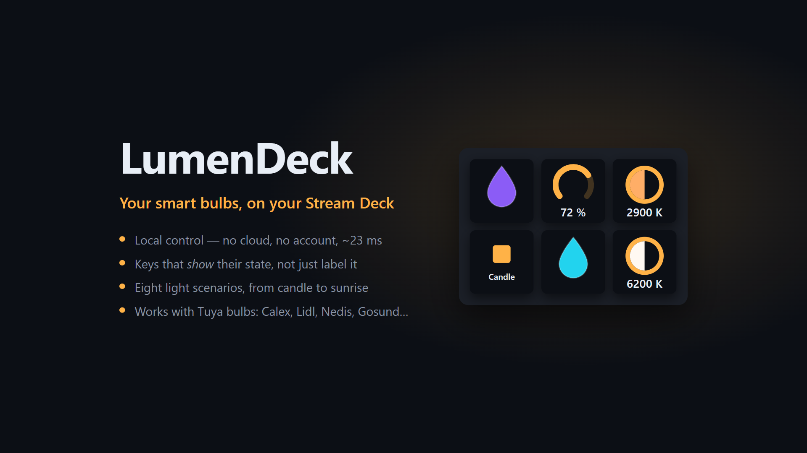

# LumenDeck




Pilotez vos ampoules connectées depuis votre Stream Deck. Une touche, et la lumière suit —
instantanément. Et si vous streamez, laissez vos viewers changer l'ambiance avec leurs points de chaîne.

## Pourquoi pas simplement l'application du fabricant ?

Parce qu'elle passe par Internet. Chaque « allume la lumière » fait un aller-retour jusqu'à un
serveur à l'autre bout du monde avant que votre ampoule ne bouge : entre un tiers de seconde et une
seconde, parfois plus quand le service rame.

LumenDeck parle **directement à l'ampoule, sur votre réseau**. Le trajet complet prend une vingtaine
de millisecondes — c'est en dessous du seuil où l'œil perçoit un délai. La lumière change *pendant*
que votre doigt appuie, pas après.

Trois conséquences agréables :

- **Ça marche sans Internet.** Box en panne, fibre coupée : vos touches fonctionnent toujours.
- **Aucune commande d'éclairage ne sort de chez vous.** Seule exception, et seulement si vous
  l'activez : la touche Twitch se connecte à Twitch pour recevoir les achats de vos viewers. Les
  lampes, elles, restent pilotées sur votre réseau.
- **Aucun compte à garder ouvert.** La configuration se fait une fois, puis on oublie.

## Ce qu'il vous faut

- Un **Stream Deck** (modèle classique ou Stream Deck+)
- Une **ampoule Calex Smart**, ou n'importe quelle ampoule pilotée par les applications
  **Smart Life** ou **Tuya** — c'est la même technologie sous plusieurs marques
- L'ampoule et l'ordinateur sur le **même réseau**

## Ce que ça sait faire

| | Sur une touche | Sur une molette (Stream Deck+) |
|---|---|---|
| **Allumer / éteindre** | un appui | appui sur la molette |
| **Intensité** | un appui = un palier | rotation continue, niveau affiché à l'écran |
| **Couleur** | applique la couleur choisie | rotation = la teinte défile |
| **Blanc chaud / froid** | applique la température choisie | rotation de 2700 K à 6500 K |
| **Scénario** | lance ou arrête une animation | appui sur la molette |
| **Twitch** | met vos viewers en pause, ou les réactive | — |

**Plusieurs ampoules par touche.** Cochez-en autant que vous voulez : une touche allume la pièce
entière, une couleur s'applique partout. Une lampe débranchée n'empêche pas les autres d'obéir.

**Huit scénarios** : clignotement, gyrophare, respiration, bougie, orage, arc-en-ciel, alerte et
lever de soleil. Un appui les lance, un second les arrête et remet chaque lampe **exactement** comme
elle était. Avec la case « Les ampoules jouent ensemble », le scénario est joué pour la pièce : la
lumière passe d'une lampe à l'autre dans l'ordre que vous choisissez, l'arc-en-ciel s'étale, les
éclairs frappent une lampe à la fois.

Les touches **montrent** leur état plutôt que de l'écrire : l'ampoule s'allume, la jauge se remplit,
la goutte prend la couleur choisie, le disque se teinte à la vraie chaleur du blanc.

Bon à savoir : couleur et blanc réglable s'excluent — choisir une température fait quitter la
couleur. C'est l'ampoule qui l'impose, pas le plugin.

## Pour les streamers : vos viewers aux commandes

Posez la touche **Twitch**, connectez votre compte une fois (un code à confirmer sur twitch.tv), et
choisissez ce que vos viewers peuvent acheter avec leurs **points de chaîne** :

- une **couleur** de la palette, d'un simple clic — rien à écrire ;
- une **couleur surprise**, tirée au hasard ;
- « **Choisis la couleur** », où le viewer tape un nom (`rouge`, `blue`, `rosa`…) ou un code `#ff8800` ;
- un **scénario**, qui dure d'autant plus longtemps que son prix est élevé, puis rend la pièce telle
  qu'elle était.

LumenDeck crée lui-même ces récompenses sur votre chaîne ; vous en changez le prix et le délai dans
votre tableau de bord Twitch. **Un viewer ne paie jamais pour rien** : un texte incompris, une
couleur trop sombre ou des ampoules injoignables, et ses points lui sont rendus. La touche Twitch
met les récompenses en pause d'un appui — elles restent visibles mais ne peuvent plus être achetées.

Il faut être **Affilié** ou **Partenaire** Twitch : les points de chaîne n'existent pas en dessous.
LumenDeck ne lit pas le chat.

## Installation

LumenDeck n'est pas encore publié sur le Marketplace Elgato. En attendant :

**[➜ Télécharger la dernière version](https://github.com/Lelio88/LumenDeck/releases/latest)**

Prenez le fichier `com.lumendeck.bulb.streamDeckPlugin` et **double-cliquez dessus** : Stream Deck
l'installe. Rien d'autre à installer, pas de ligne de commande.

Une catégorie **LumenDeck** apparaît alors dans Stream Deck avec ses six actions, à glisser sur une
touche. Seul prérequis : l'application Stream Deck en **7.1 minimum**.

<details>
<summary>Construire le paquet soi-même</summary>

Depuis ce dossier, avec **Node 24 ou plus** :

```bash
npm install
npm run pack
```

Le fichier apparaît dans `dist/`. Node n'est nécessaire qu'à la construction — le plugin, lui,
tourne sur le Node embarqué de Stream Deck. Le dossier du dépôt n'a ensuite plus aucune utilité,
vous pouvez le supprimer.
</details>

<details>
<summary>Si vous comptez modifier le code</summary>

`npm run deploy` rattache le plugin au dossier du dépôt et le recharge, ce qui évite de réinstaller
après chaque modification. Le plugin dépend alors de ce dossier : ne le déplacez pas. Les deux modes
s'excluent — pour repasser en installation autonome, `npx streamdeck unlink com.lumendeck.bulb`
d'abord.
</details>

## La configuration, une bonne fois pour toutes

Pour parler à votre ampoule sans passer par le cloud, LumenDeck a besoin de deux informations
qu'elle seule détient : son identifiant et sa clé.

**Tout se passe dans le panneau de réglages d'une touche**, rubrique « Ajouter des ampoules ».
Onglet **Appli Calex (QR)** : collez le **code utilisateur** que votre application affiche (Moi →
Paramètres → Compte et sécurité), cliquez sur « Afficher le QR code » et scannez-le avec
l'application (**+** → **Scanner**). Toutes vos ampoules sont enregistrées d'un coup, et LumenDeck
retrouve seul leur adresse sur votre réseau. Comptez deux minutes, une seule fois.

Vos ampoules apparaissent ensuite dans « Mes ampoules », avec une pastille verte quand elles
répondent. Une ampoule qui a changé d'adresse ? L'onglet **Sur le réseau** la retrouve.

Ces informations restent sur votre machine. La clé ne vaut que sur votre réseau : elle ne donne
accès à rien d'autre, et elle se renouvelle si vous ré-appairez l'ampoule.

> Procédure pas à pas : [`docs/configuration.md`](./docs/configuration.md).

## Bon à savoir

L'extension parle **anglais, français, allemand, espagnol, italien, japonais, coréen et chinois**
(simplifié et traditionnel), et suit la langue de Stream Deck.

Sous licence **MIT** : faites-en ce que vous voulez, sans garantie.

**Ce projet n'est pas affilié à Calex, à Tuya ni à Twitch.** C'est un projet personnel, qui utilise
le protocole local que ces ampoules exposent déjà sur votre réseau.

Il est jeune, et n'a été éprouvé que sur un modèle (Calex « LED SMART »). Si vous en essayez un autre,
le retour est bienvenu.

---

*Développeurs : l'architecture, les contraintes et la façon de contribuer sont décrites dans
[`CLAUDE.md`](./CLAUDE.md) et [`docs/architecture.md`](./docs/architecture.md).*
